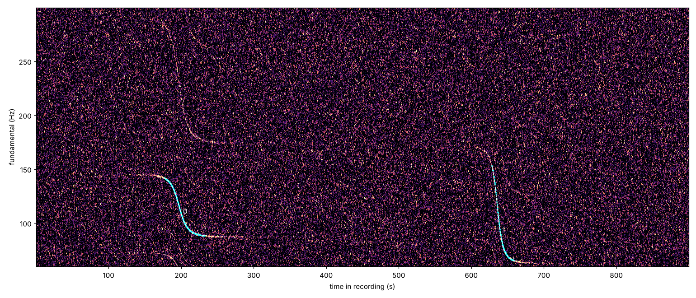
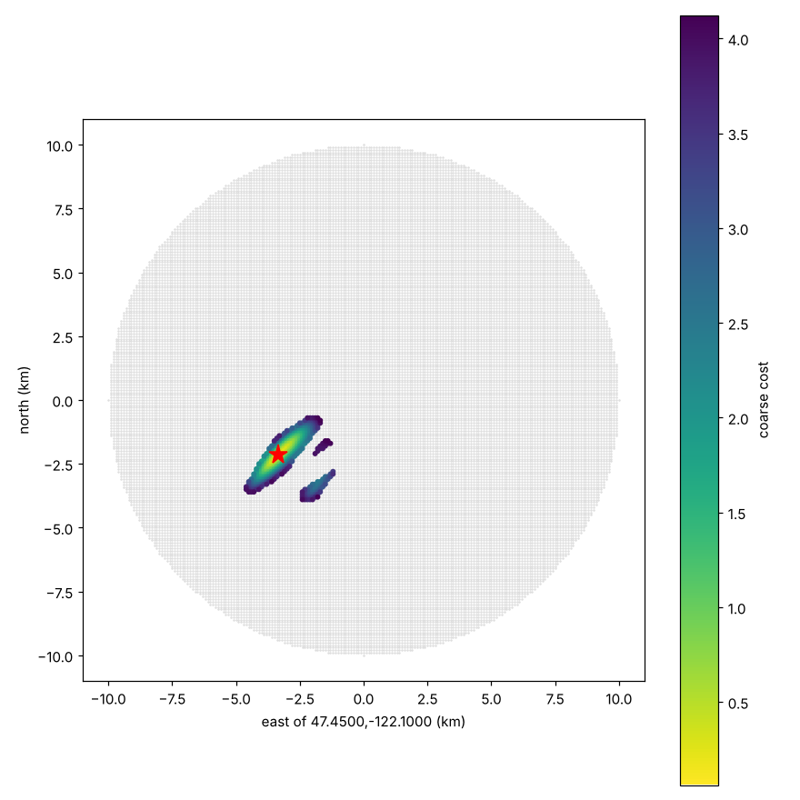

# planeloc: geolocating audio from aircraft Doppler curves

A from-scratch reimplementation of the technique in colsto's video
["I discovered a sound that leaks your exact location"](https://www.youtube.com/watch?v=UytYrhYLOKI).
A recording that faintly captures passing aircraft contains Doppler curves. Historical ADS-B
data records where every transponder-equipped aircraft was, second by second. Find the ground
point and start time at which the ADS-B tracks would produce exactly those curves.

The original author released no code. Everything here is derived from the physics.

## How it works

### 1. Physics

An aircraft emits tones from propeller blade-passage, fan, or engine harmonics, typically
50–300 Hz for props and up to a few kHz for jet fans. A stationary microphone hears

```
f(t_r) = f0 · c / (c + dr/dt_e),     t_r = t_e + r(t_e) / c
```

where `r` is the slant range and `t_e` is the emission time. Using emission time, i.e. retarded
time, matters at the 1 Hz level. For a straight constant-speed pass this gives the familiar
falling S-curve. The curve's shape encodes three things:

| curve feature | gives |
|---|---|
| frequency ratio before vs after | speed `v` (`(f_hi − f_lo)/(f_hi + f_lo) = v/c`) |
| steepness at the midpoint | closest-approach slant distance `d` (`slope ≈ f0·v²/(c·d)`) |
| midpoint time | time of closest approach `t_ca` (relative to the recording start) |

`physics.straight_pass` solves the retarded-time quadratic in closed form, so fitting is fast.

### 2. Curve extraction (`planeloc events`)

1. Decode the audio with soundfile, or with ffmpeg for any video container. Resample, then take an STFT (1 s window, 0.1 s hop, 4× zero-padding).
2. Whiten: take log power, subtract the per-bin median (removes stationary hum) and the per-frame median (removes wind gusts), and scale by MAD.
3. Harmonic sum: score each candidate fundamental by `Σ_k z(k·f)`. This suppresses noise and makes the tracker lock onto the fundamental rather than a harmonic.
4. Track the ridge with Viterbi, bounding the per-frame jump by a maximum slope in Hz/s. Refine each frame with sub-bin parabolic interpolation.
5. Segment events by hysteresis on ridge SNR.
6. Fit the straight-pass model to each event with robust least squares (soft-L1, multi-start over `d`, outlier rejection). Output `f0, v, d, t_ca` and their standard errors.



### 3. Search (`planeloc locate`)

Unknowns are the observer position `(e, n)` and the absolute start time `T0`.

**Stage A (coarse, vectorised).** For every grid point and every ADS-B track segment, compute
the closest point of approach: slant range, 3-D speed, and reception time of the CPA sound.
An event matches a (point, flight) pair if `|r_min − d|` and `|speed − v|` are within tolerance
and the implied `T0 = t_ca_abs − t_ca_rel` lies in the search window. With two or more events,
the implied `T0` must agree across events. The fixed gap between flyovers in the recording is
what turns a "ring of plausible points" into a single spot. An optional silence check penalises
solutions where some other aircraft passed closer than `--silence-range` during the recording
but wasn't heard.

**Stage B (fine).** For the best coarse candidates, run Nelder–Mead over `(e, n, T0)`. It
compares the full retarded-time Doppler curve, computed along the real ADS-B track (turns,
climbs and all), against the observed ridge. `f0` is solved per event in closed form, with a
Huber loss.



## Results on synthetic data

`examples/eval_synthetic.py` builds random worlds: a hidden observer, 60 background flights,
two guaranteed flyovers, noisy ADS-B sampled at 1–8 s with 25 ft altitude quantisation, and
audio with white plus low-frequency noise. The start-time window is ±1 h.

```
seed 0: 3 events, error  7 m, dT0 +0.1 s
seed 1: 2 events, error  7 m, dT0 -0.0 s
...
solved 8/8 within 500 m; median error 6 m
```

Sensitivity checks:

* **Speed-of-sound error.** Assuming 0 °C or 30 °C when the truth is 15 °C gives about 120–130 m error and about 1 s of timing bias.
* **A single event is not enough.** With a ±1 h window, or even a ±60 s clock, the solution slides along the flight track and lands 1–10 km off. You need **≥ 2 flyovers**, or one flyover plus a well-known clock and a small search area.

These numbers come from an idealised world: straight-line sound propagation, no wind,
geometric altitudes, and tones that are clearly present. Real recordings will be worse. See
the limitations below.

## Running it

```bash
uv venv && . .venv/bin/activate && uv pip install -e '.[test]'
pytest -q

# Synthetic end-to-end
planeloc simulate --out sim --seed 3
planeloc events sim/recording.wav --fmin 60 --fmax 300 --plot sim/events.png --out sim/events.json
planeloc locate sim/events.json --adsb sim/adsb.csv --center 47.45,-122.10 --radius 10000 \
    --t-lo 2025-06-15T18:30:00Z --t-hi 2025-06-15T20:30:00Z --ground-h 60 --silence-range 1000 \
    --plot sim/locate.png --out sim/result.json
```

### On a real recording

1. **Look at the spectrogram first.** Run `planeloc events clip.mp4 --plot ev.png` with a wide band (e.g. `--fmin 40 --fmax 400`). Look for falling S-curves, then narrow `--fmin/--fmax` to the band that holds one clean fundamental. If two aircraft overlap, or the auto segmentation picks up junk, pass explicit `--window start:end` per flyover. Check that each fit's `rms` is under about 0.5 Hz and that `v` is plausible (props 50–100 m/s, jets on approach 70–150 m/s).
2. **Bound the search.** You need some prior on where (a region of tens of km) and when (a day, or a few hours). Compute cost scales as `grid points × flights × events`. A 10 km radius at 100 m spacing with a few hundred flights takes seconds. A whole metro area at 100 m with a day of traffic is minutes to hours.
3. **Get ADS-B for that region and time.**
   * **adsb.lol globe_history.** Free daily archives of readsb `trace_full_<icao>.json` files, released on GitHub (`adsblol/globe_history_<year>`, split tar). Extract one day, then `planeloc adsb --adsb <extracted_dir> --center lat,lon --radius 40000 --start … --end … --out adsb.csv`.
   * **OpenSky** (research access). `pip install pyopensky`, configure credentials, then pass `--opensky`.
   * **Any CSV** with `icao,time,lat,lon,alt_m`. Prefer geometric (GNSS) altitude, because barometric altitude is off by up to a few hundred metres depending on the day's pressure.
4. **Locate.** Run `planeloc locate events.json --adsb adsb.csv --center … --radius … --t-lo … --t-hi … --ground-h <terrain ellipsoid height> --temp <°C>`. Check the margin printed between the best and runner-up solutions. A margin close to 1 means the result is ambiguous.

## Limitations

* **Straight-line, still-air propagation.** Wind adds roughly `±wind·cosθ` to the effective `c` and biases `v` by the along-track wind component. Temperature gradients bend rays. Expect a few hundred metres of error from these effects.
* **Ground elevation is a constant.** Pass `--ground-h`. A DEM lookup is not implemented, so hilly terrain adds vertical error, and that error maps partly into horizontal error.
* **One closest approach per flight per grid point.** Aircraft that loiter or circle (pattern work, helicopters) are handled only partially. Stage B uses the full track, but stage A can miss the second pass.
* **Coverage gaps.** Aircraft without ADS-B (many GA aircraft, military) can't be matched. They also make the silence check unreliable, which is why it is a penalty, not a hard filter.
* **The tracker follows a single ridge.** With overlapping flyovers, use manual windows.
* **No validation on real recordings yet.** The pipeline has been checked only on synthetic data.
